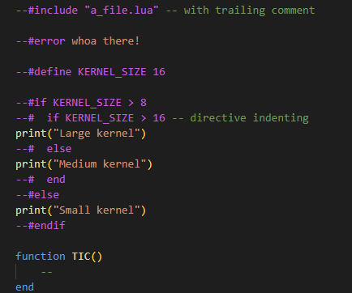

# ticbuild

A build & watch system for TIC-80 cart development.

* Multi-file Lua dev system
* TypeScript transpiling natively supported (yes, write TIC-80 carts in a typed language)
* Watch system: live-update a running tic80 when dependent files are updated.
* Sprites, music, map data import from existing carts
* Lua preprocessing (`#include`, `#macro`, `#if`, et al)
* Code size up to 512kb
* Timing and profiling information
* Encoding, importing tools

## Links

* [TIC-80 homepage](https://tic80.com/)
* [ticbuild on Github (this project)](https://github.com/thenfour/ticbuild)
* [ticbuild_vscode on Github](https://github.com/thenfour/ticbuild_vscode)
* [Discord](https://discord.gg/kkf9gQfKAd)
* [Somatic - web-based TIC-80 music tracker](https://somatic.tenfourmusic.net/)


This project is free, a labor of love; if you find it useful, please support by spreading the word or,

[](https://ko-fi.com/E1E71QVJ5Z)

# 2-minute quick start

The best dev experience is through:

* Windows
* VS Code as your editor

If you're cool with that, this is going to be easy. Open a command prompt and follow this:

```bash
# Install ticbuild so it's usable on the system as `ticbuild`
> npm install -g ticbuild

# go where you want to create the project
> cd c:\my_projects

# Initialize a minimal example project
> ticbuild init MyDemo

# Open VS Code
> code MyDemo
```

In VS Code, hit <kbd>F5</kbd> to build and watch for changes. A TIC-80 opens
with the example project.

Open `src/main.lua`. Change the background color:

```lua
  cls(9) -- changed from cls(0)
```

When you save the file, violà, the TIC-80 shows the new background color.

Also notice the TIC-80 shows timing and FPS information.


For the full experience, now install [the VS Code syntax highlighting extension](https://marketplace.visualstudio.com/items?itemName=TridentLoop.ticbuild-vs-code)

And you will get full syntax highlighting for the Lua language extensions.

# Installation

Install ticbuild globally using npm:

```bash
npm install -g ticbuild
```

## Lua preprocessor + syntax highlighting

See [ticbuild_vscode](https://github.com/thenfour/ticbuild_vscode) for adding
syntax highlighting to make the Lua preprocessing more friendly in VS Code.




## Prerequisites

- Windows (most is cross-platform however launching is strictly windows)
- Node.js (v16 or higher)

# How to use: overview

```bash

# see detailed help
ticbuild help

# see help for a specific command
ticbuild help build

# build from manifest -> .tic cart
ticbuild build

# build and launch in a tic80
ticbuild run

# build, live-update, and attach an interactive TIC-80 terminal
ticbuild watch

# create a new empty project
ticbuild init

# inspect an existing cart
ticbuild inspect path/to/cart.tic

```

## Machine-readable build output

`ticbuild build` uses the human-readable reporter by default. Use the JSONL
reporter when another program needs to consume build messages:

```bash
ticbuild build --reporter jsonl
```

Every build also produces `build.jsonl` in the obj dir. One JSON object per line.
Lines look like:

```json
{"version":1,"type":"comment","data":{"message":"Loading imported resources..."}}
```

- `version` is the schema/contract version.
- `type` determines the shape of `data`.
- `data` contains raw values such as byte counts, durations, resolved paths...
  Human-readable formatting is not part of the JSONL contract.

Version 1 defines these message types:

- `project.loadedFrom`: resolved source manifest path.
- `manifest.resolved`: path of the generated resolved manifest.
- `comment`: display-only text. Readers must not derive build semantics from it.
- `diagnostic`: a warning or error message.
- `lua.codeSize`: raw Lua chunk sizes, capacities, and bank usage.
- `lua.minification`: emitted when Lua's 200-active-local limit causes profitable aliases to be omitted;
  includes the constrained function, peak existing/generated locals, per-rule omissions, and estimated bytes not saved.
- `cart.usage`: raw emitted-cart chunk and total-size information.
- `build.completed`: successful terminal message with duration, log path, trace path, and cart path.
- `build.failed`: failed terminal message with the error text and, when available, the partial trace path.

`build.trace.json` is also a build output containing a performance profile of
the build. It uses the Chrome Trace Event JSON format.

- [Reference 1 Google Doc](https://docs.google.com/document/d/1CvAClvFfyA5R-PhYUmn5OOQtYMH4h6I0nSsKchNAySU/preview?tab=t.0#heading=h.yr4qxyxotyw)

The profile trace can be opened in various tools for analysis.

- Chrome dev tools (F12) - performance tab, open profile.
- [Perfetto](https://ui.perfetto.dev/)
- I think Speedscope also supports it

## dev-only code pipeline lab

```bash
npm run dev:code-pipeline
```

Starts a web app for exploring Lua preprocessing/minification and
TypeScript-to-Lua pipeline.

It's possible to operate the server over a specific project / build configuration:

```powershell
$env:TICBUILD_PLAYGROUND_MANIFEST = "C:\path\to\project.ticbuild.jsonc"
$env:TICBUILD_PLAYGROUND_MODE = "release"
npm run dev:code-pipeline
```

Also available are:

- `npm run build:code-pipeline`
- `npm run preview:code-pipeline`

## dev-only LZ compressor sandbox

```bash
npm run dev:lz-compressor
```

Starts a web app for testing LZ/LZRLE compression and other import stream encodings. Input source binary in various encodings:
HEX, UTF-8, BASE64, and ticbuild BASE85+1 payloads,
and  perform the same LZ/LZRLE compression preset search used by `__IMPORT` / `__ENCODE`.

Also available are:

- `npm run build:lz-compressor`
- `npm run preview:lz-compressor`
- `npm run benchmark:lz-configs`

## LZ and LZRLE stream format

Both formats are byte streams made from tagged operations. Every integer field is an
unsigned LEB128 varint. The decoder stops after consuming the complete compressed byte
sequence; there is no terminator or decompressed-size header.

| Tag  | Fields                        | Operation |
| ---- | ----------------------------- | --------- |
| `00` | `length`, then `length` bytes | Copy literal bytes from the stream. |
| `80` | `length`, `distance`          | Copy from `distance` bytes behind the current output position. Overlapping copies are allowed. |
| `81` | `length`, `value`             | Write `value` repeatedly. Only allowed for LZRLE profiles |

Every LZ stream is a valid LZRLE stream. The LZRLE encoder searches both
the base and RLE-enabled form of each numeric preset, so it emits `81` only when doing so
actually makes the payload smaller.

Runtime code using base `LZ` may omit the `81` branch; runtime code using `LZRLE` must include it.

This plain Lua reference decoder accepts both profiles. It takes a dense, 1-based
array-like table of compressed bytes and returns a new dense, 1-based byte table.

```lua
local function lz_varint(src, si)
  local value, factor = 0, 1
  while true do
    local byte = src[si]
    -- skip error checking if you're certain the payload is correct
    if byte == nil then error("truncated LZ varint") end
    si = si + 1
    value = value + (byte % 0x80) * factor
    if byte < 0x80 then return value, si end
    factor = factor * 0x80
  end
end

-- Decode a dense 1-based byte table into a new dense 1-based byte table.
function unlzrle(src)
  local dst = {}
  local si = 1
  while si <= #src do
    local tag = src[si]
    si = si + 1

    if tag == 0x00 then
      local length
      length, si = lz_varint(src, si)
      if si + length - 1 > #src then error("truncated LZ literal") end -- skip error checking if you're certain the payload is correct
      for _ = 1, length do
        dst[#dst + 1] = src[si]
        si = si + 1
      end
    elseif tag == 0x80 then
      local length, distance
      length, si = lz_varint(src, si)
      distance, si = lz_varint(src, si)
      if distance < 1 or distance > #dst then error("invalid LZ distance") end
      for _ = 1, length do
        dst[#dst + 1] = dst[#dst - distance + 1]
      end
    elseif tag == 0x81 then -- this branch can be omitted if you are not using RLE
      local length
      length, si = lz_varint(src, si)
      local value = src[si]
      if value == nil then error("truncated LZRLE run") end
      si = si + 1
      for _ = 1, length do
        dst[#dst + 1] = value
      end
    else -- again, skipping error handling is optional.
      error("unknown LZ tag: " .. tag)
    end
  end
  return dst
end
```

## Project variables (in manifest) vs. environment (`.env`, `.env.local`)

Project variables and environment values are in separate buckets but both available
in your project:

Environment is applied in this priority (high to low):

1. `--env NAME=value` via command line
2. Actuall calling process environment variables
2. `.env.local` file
3. `.env` file

```bash
ticbuild build --env BUILD_MODE=debug --env FEATURE_X=1
```

From Lua:

```lua
-- Accessing environment variable:
local x = __EXPAND("$(env:TIC80_LOCATION)")
-- Accessing a project var:
local x = __EXPAND("$(project.name)")
```

From TypeScript:

```typescript
// environment variable
const x = ticbuild.Expand("$(env:TIC80_LOCATION)");

// project var:
const x = ticbuild.Expand("$(project.name)");
// or,
const x = ticbuild.Vars["project.name"];
```

## TIC-80 binary location

By default, `ticbuild` will use a special build of TIC-80 which allows profiling and
interop to support remote control.

To specify which TIC-80 executable to launch, set `USE_EXTERNAL_TIC80=1`, and
set `TIC80_LOCATION`.

```bash
USE_EXTERNAL_TIC80=1                    # use own build of tic80.exe. defaults to falsy
TIC80_LOCATION=c:\my\custom\tic80.exe # optional. ignored without USE_EXTERNAL_TIC80=1
```

# Project files

ticbuild projects contain some files that ticbuild depends on or
publishes updates to. After updating ticbuild, you can check these assets:

```bash
ticbuild project check [manifest]
```

Something need updating? Perform the update automatically:

```bash
ticbuild project update [manifest]
```

User-editable config like `.env`, `.vscode/*` are not modified by
`project update`, ticbuild assumes you own that config. But if missing, they get
replaced.

# Project manifest

The manifest file is canonically `*.ticbuild.jsonc`. Its location defines the project root.

```jsonc
// paths are always relative to the manifest file's dir (which defines the project root dir)
// fyi, reference: https://github.com/nesbox/TIC-80/wiki/.tic-File-Format
{
  "$schema": "./.ticbuild/ticbuild.schema.json",
  "buildConfiguration": "release", // base configuration name (required, gets overridden by other configs)
  "project": {
    "name": "my demo",
    "launchArgs": ["--fs=./", "--skip"], // args that are passed to the tic80 when launched.
    "includeDirs": ["./src", "./include"], // includes these dirs in source file lookup
    "importDirs": ["./assets", "./images"], // include these dirs in resource import lookup
    // optional extra watch targets used by ticbuild watch
    "additionalWatchGlobs": ["./tools/**/*.json", "./shared/**/*.lua"],

    // emits metadata comments at the top of the final Lua source, after
    // minification so it survives normal comment stripping.
    // emitted in the insertion order.
    // values must be single-line strings.
    "metadata": {
      "title": "game title",
      "author": "game developer, email, etc.",
      "menu": "MENU1 MENU2 MENU3"
    },
    "binDir": "./dist/bin",
    "objDir": "./dist/obj",
    "outputCartName": "$(project.name).tic" // leaf name only
  },
  "variables": {
    "anything": "here", // variables can be referred to in values via $(variablename)
  },
  "preprocessor": {
    "defines": {
      "RELEASE": true,
      "GEOSPHERE_SUBDIVISIONS": 3,
      "CURVE_BETA": 0.998,
      "TITLE": "$(project.name)", // variable substitutions is performed just like most things in the manifest.
      "SUBTITLE": "The best one ever"
    }
  },
  "imports": [
    {
      "name": "maincode", // symbolic identifier
      "path": "main.lua",
      "kind": "LuaCode", // defines the type of importer to handle this.
    },
    {
      "name": "twilight_bog_palette", // https://lospec.com/palette-list/twilight-bog
      "kind": "binary", // the imported resource is treated as binary data.

      // the way it's represented in its source may not be a binary file; we can decode the source data.
      // see below for detailed info about encoding types
      "sourceEncoding": "hex",
      // like other resources, loading from file is fine:
      // "path": "path_to_file.bin"

      // but you can also just specify the value here.
      // NOTE: as with all (most?) manifest values, string substitions are performed so variables
      // can be used.
      "value": "1f17143439434e5a6d5d8da289baabb8cfb9839c77727546383f38704b63a66470b8948ec8bfbfe1e6eaa48db6785a96",
    },
    {
      "name": "scroll_text",
      "kind": "text", // the imported resource is treated as plain text
      // like other resources, loading from file is fine:
      // "path": "path_to_file.txt"
      // but you can also just specify the value here. Again, string substitution is supported.
      "value": "greetz to everyone at the party",
    },
    {
      // A command source produces an asset via a system command.
      // The command runs once per build when used.
      // CWD = project directory
      "name": "shipLarge_png",
      "kind": "binary",
      "command": {
        "executable": "python",
        "args": ["./scripts/processImage.py", "./images/shipLarge.png"],
        "outputFile": "./generated/shipLarge.png.bin", // the asset binary
        // These inputs trigger watch rebuilds. outputFile is generated and is not watched.
        "fileDependencies": ["./scripts/processImage.py", "./images/shipLarge.png"],
      },
    },
    // it is not necessary to specify all source files here; main.lua can import
    // files directly by relative path.
    {
      "name": "myGraphics",
      "path": "./carts/sprites.tic", // imports from some other cartridge

      // you can filter which chunks to include. The chunk types are hard-coded
      // corresponding to the TIC-80 cart chunks.
      // see chunk types @ https://github.com/nesbox/TIC-80/wiki/.tic-File-Format
      // see elsewhere in this README for details on specific chunk type behaviors.
      //
      // Bringing in multiple chunks though means that 1 import can have multiple
      // sub-assets (payloads). In this case, "myGraphics" contains tiles and sprites.
      //
      // When you refer to an import ("myGraphics" in #import, __IMPORT, or the `assembly` section),
      // you can specify sub asset(s) you actually want. Typically that means
      // omitting chunks[] / bank will use all available; specifying will filter.
      // 
      // NOTE: CODE is handled specially: concatenated on load;
      // viewable only as a bank 0 code chunk
      // and auto-split into banks on cart saving.
      // see elsewhere in this readme for details about CODE behavior.
      "chunks": ["TILES", "SPRITES"],
      "kind": "Tic80Cartridge", // again this could be deduced.

      // filter to a specific 0-based source bank. if omitted, all present banks are pulled in.
      "bank": 4,
    },
    {
      "name": "music-imported-cart",
      "path": "./carts/song.tic",
      // you can also omit the chunks and we'll just import all available from a cart.
      "chunks": [
        "CODE",
        "WAVEFORMS",
        "MUSIC_PATTERNS",
        "SFX",
        "MUSIC_TRACKS",
      ],
      // MAYBE in the future we can add other ways to query like to pull in a specific sprite.
      // but for now not necessary.

      // Note: the code that's imported from a cart can contain ticbuild preprocessing directives.
      // this could be useful for example in Somatic, to wrap TIC() with a --#if false --#endif
      // which would basically remove the entrypoint
    },
  ],
  "assembly": {
    "lua": {
      "minify": true,
      "minification": {
        // options here are exactly those of OptimizationRuleOptions
        // Defaults are LUA_RELEASE_OPTIMIZATION_OPTIONS
        "stripComments": true,
        "maxIndentLevel": 1,
        // "traceable" puts each diagnostic Lua anchor on its own generated line
        // for precise source mapping of line-only runtime errors. Intended for debug builds.
        // "tight2" removes all lexically optional whitespace while respecting maxLineLength.
        "lineBehavior": "tight", // "pretty" | "tight" | "tight2" | "single-line-blocks" | "traceable";
        "maxLineLength": 180,
        "aliasRepeatedExpressions": true,
        "renameLocalVariables": true,
        "aliasLiterals": true,
        "packLocalDeclarations": true,
        "simplifyExpressions": true,
        "removeUnusedLocals": true,
        "removeUnusedFunctions": false,
        "functionNamesToKeep": ["TIC", "BDR", "SCN"], // TIC-80 constants by default
        "renameTableFields": false,
        "tableEntryKeysToRename": [],
        // default "opt-in" when this is omitted. New
        // projects use "opt-out" so globals defined by the final Lua file are
        // renamed unless explicitly preserved.
        "globalSymbolRenaming": "opt-in", // "off" | "opt-in" | "opt-out"
        "globalSymbolsToRename": [],
        "globalSymbolsToKeep": [],
      },
    },
    "blocks": [
      {
        // error if overlapping/colliding chunks.
        // you can specify CODE_COMPRESSED for the ZLIB compressed version.

        // "chunks" is slightly ambiguous but effectively it defines the OUTPUT CHUNK(s),
        // which can be implicit from the source.
        // an empty array therefore does specify, albeit no output. Allowed but will output a
        // warning.
        //
        // for single input payloads (single-bank-single-chunk) AND single output payload (bank-chunk),
        // this enables the possibility of "remapping" chunk types.
        //
        // single input payload + multiple output payload is an error (e.g. it's not possible to map
        // a single TILES to multiple chunk types in 1 block entry)
        //
        // for multiple input payloads, this list filters the selected payloads by type.
        // At least one type must match.
        "chunks": ["CODE"],

        // An explicit destination bank requires one selected payload per output type.
        // Omit it to preserve the selected asset banks (note: CODE will bank-split automatically).
        // Rationale:
        //  - this allows multi-bank imports to output also as multiple banks
        //    use-case: basically using ticbuild in a daisy-chain flow; minimally
        //    taking an existing cart and outputting the same cart without having
        //    to specify every chunk & bank.
        //  - it allows retaining the original bank without having to repeat that info.
        //    if you want to move something from bank 4 to bank 2, it's natural that you
        //    must be explicit. But if you want to move from bank 4 to <same bank>, this
        //    allows doing that.
        // that's the only way to output multiple banks in 1 block entry.
        // Q: what if they overlap with other assembly entries?
        //  -> same logic as specifying dupe chunk/bank in separate entries. error; do not concat or override
        // Q: if two payloads of the same type would both land in the destination bank?
        //  -> error; select a single source bank.
        // Q: multiple chunks specified, each spanning only 1 bank, but they're different banks?
        //  -> then specifying a bank here will "flatten" them so they all end up in this bank.
        // Q: what if the payload doesn't fit in the destination chunk?
        //  -> error. CODE and CODE_COMPRESSED can split automatically when bank is omitted.
        //
        // if the import asset doesn't have a bank (e.g. a raw binary file) then
        // defaults to bank 0.
        "asset": "maincode",
        "code": { // optional code assemblyl options
          // when applicable (currently only CODE_COMPRESSED), high-level compression options.
          "compressionMode": "default", // "default" | "zlib-max" | "zopfli"
          // private TIC-80 extension: allow uncompressed CODE to span up to 16 banks.
          "extendedCodeBanks": false,
          // private TIC-80 extension: allow CODE_COMPRESSED to span multiple banks.
          "multiBankCompressedCode": false,
        },
      },
      {
        // Binary and text resources need one explicit destination chunk type.
        // this example uses MAP to store custom data.
        "chunks": ["MAP"],
        "asset": "twilight_bog_palette"
      },
      {
        // Copy waveforms from source bank 1 into MAP at output bank 4.
        // Q: what if the imported selection contains WAVEFORMS in *multiple* banks, and you specify
        //    outputting  to just "TILES"?
        //  -> invalid; "remapping" only works for single payloads. it's too obscure to attempt doing some
        //     kind of smart mapping. if you have 7 banks of tiles and you want to output them as waveforms (why?),
        //     that means you'll need 7 assembly output entries, each remapping the individual banks

        // canonical form:
        "asset": {
          "import": "music-imported-cart",

          // chunks & bank are thought of as filter criteria. must match chunks AND bank.
          // so if import contains:
          // - bank 0 WAVEFORMS
          // - bank 1 WAVEFORMS
          // - bank 1 MUSIC_PATTERNS
          // then if you specify:
          // chunks:["WAVEFORMS"] -> both banks of waveforms.
          // chunks:["WAVEFORMS"], bank:0 -> WAVEFORMS:0
          // chunks:["WAVEFORMS", "MUSIC_PATTERNS"], bank:0 -> WAVEFORMS:0
          // chunks:["WAVEFORMS", "MUSIC_PATTERNS"] -> all 3 payloads
          // ! at least 1 payload must result. if no payloads are present in the result, error.
          "chunks": ["WAVEFORMS"],
          "bank": 1
        },

        // equivalent shorthand for asset: "import:music-imported-cart:WAVEFORMS:1"
        "chunks": ["MAP"],
        "bank": 4,
      },
    ],
  },

  "buildConfigurations": {
    // build configurations are named overrides  of the base config above.
    // you cannot override individual elements of arrays. for example, `assembly.blocks`
    // if you override that, you must overwrite the whole value.
    // similar with includeDirs / additionalWatchGlobs, you can't "add 1" or so; you have to replace the whole array.
    "debug": {
      "project": {
        "binDir": "./debug/bin",
        "objDir": "./debug/obj",
      },
      "variables": {
        "anything": "overridden",
      },
      "preprocessor": {
        "defines": {
          "RELEASE": null, // null removes a define from the base config
          "DEBUG": true,
        },
      },
      "assembly": {
        "lua": {
          "minify": false, // overrides
        },
      },
    },
  },
};
```

When running `ticbuild watch`, ticbuild watches the manifest file and
project dependencies discovered during build. With the bundled TIC-80, it
also displays events such as `trace` and `script_error` in
real time and accepts remoting commands such as `ping`.

`script_error` events and `script_error_last` responses are made to be more 
human-readible  than the raw  protocol JSON/encoded value. These specifically
are rendered as readable stack traces and mapped
back to authored sources when the running cart matches the build source maps.

Request ID prefixes are optional (e.g. `1 ping`).

Use `--on-connect` options with `terminal` or `watch` to send
remoting commands immediately after terminal setup. 

An `ERR` response, timeout, or disconnect stops the sequence and ticbuild exits
non-zero.

Use `--hide-trace-containing "my.token"` or
`--hide-trace-matching "reg.*ex"` with `terminal` or `watch` to suppress noisy
`trace` events by payload. Case-sensitive; the matching form
uses JavaScript regular-expression syntax. When both are supplied, either match
hides the event.

Prefix a command to select how its response is presented:

- `!script_error_last` decodes and prints the structured JSON value without
  human-readable stack-trace formatting.
- `#script_error_last` prints the exact raw protocol response, including its
  hex-encoded binary value.

The presentation prefix follows an explicit request ID when one is supplied,
for example `42 !script_error_last`.

Use `project.additionalWatchGlobs` to add extra glob-based watch targets,
relative to the manifest directory unless you provide an absolute pattern.
These extra globs can trigger rebuilds on file changes, file additions, and file removals.

`additionalWatchGlobs` is an array value, so build configurations replace the whole array when overriding it.

# Chunk types

TIC-80 carts contain specific semantic chunks; see https://github.com/nesbox/TIC-80/wiki/.tic-File-Format.

Cart imports retain chunk & bank info except for `CODE`.

| ID | Manifest name | Banks | Maximum bytes per bank |
| ---: | --- | --- | ---: |
| 1 | `TILES` | 0–7 | 8,192 |
| 2 | `SPRITES` | 0–7 | 8,192 |
| 4 | `MAP` | 0–7 | 32,640 |
| 5 | `CODE` | Logical bank 0. Assembly splits across banks. | 65,536 |
| 6 | `FLAGS` | 0–7 | 512 |
| 9 | `SFX` | 0–7 | 4,224 |
| 10 | `WAVEFORMS` | 0–7 | 256 |
| 12 | `PALETTE` | 0–7 | 96 |
| 14 | `MUSIC_TRACKS` | 0–7 | 408 |
| 15 | `MUSIC_PATTERNS` | 0–7 | 11,520 |
| 16 | `CODE_COMPRESSED` | Bank 0 in stock carts; Banks 0–15 in the private format. | 65,535 |
| 17 | `DEFAULT` | 0–7 | 0 |
| 18 | `SCREEN` | 0–7 | 16,320 |
| 19 | `CODE_WASM` | Recognized on import. Nonempty output is unsupported. | — |

`DEFAULT` carries the marker for TIC-80's built-in palette and waveforms. It is
copied as a marker. Import `DEFAULT` to retain it in your output.

# TypeScript code

Start a TypeScript project with:

```bash
ticbuild init my-demo --template typescript
cd my-demo
```

`ticbuild init` installs the generated project's npm dependencies automatically.
The generated TypeScript project includes TIC-80 and ticbuild declarations plus
ESLint rules [recommended by TypeScriptToLua](https://typescripttolua.github.io/docs/caveats).

```bash
npm run check # to typecheck and lint
npm run lint  # lint only
```

Linting remains independent from `ticbuild`.
The lint toolchain requires Node.js 20.19 or newer.

To add a `.ts` source asset manually:

```jsonc
{
  "name": "maincode",
  "path": "src/main.ts",
  "kind": "TypeScriptCode",
  "typescript": { // optional
    "tsconfig": "./tsconfig.json"
  }
}
```

Compiler plugins, TypeScriptToLua plugins, project references,
and `noResolvePaths` are not supported yet.

ticbuild uses [TypeScriptToLua](https://github.com/TypeScriptToLua/TypeScriptToLua) to
provide native transpiling to Lua. So yes the output cart is in Lua.

- See the [TypeScriptToLua documentation](https://typescripttolua.github.io/) for how the system works.
- See especially [the caveats section](https://typescripttolua.github.io/docs/caveats) to understand
  how to avoid problems when doing so.

# TypeScript caveat: preprocessor and compile-time constants

ticbuild preprocessor directives kinda sorta work in typescript, with a lot of asterisks.
They are NOT evaluated in typescript; they pass through to Lua and are evaluated normally
there. Use `//--#...` spelling.

```ts
// This works:
const TIC = () => {
  //--#ifdef DEBUG
  trace(__EXPAND("$(project.name) debug build"));
  //--#endif
};
```

However there are a LOT of asterisks. The typescript source must actually be correct
typescript because preprocessor directives are only evaluated after tsc and transpilation.

```ts
// This fails:
const TIC = () => {
  //--#ifdef DEBUG
  const a = 1;
  //--#else
  const a = 2; // duplicate definition of `a`.
  //--#endif
};
```

Another caveat is that in order for these directives to survive through transpilation,
we mark their location with a generated marker, do the tsc & transpile step, then
replace the markers with the source directives.

Those internal markers:

- look like function calls (because it's the safest syntax i could think of)
- cannot be comments themselves; they must be "live-looking code".

But a "function call" marker fails in many contexts. So the following also fails:

```ts
// This fails:
const Strings = {
  //--#ifdef DEBUG
  DebugName: "James",
  //--#else
  ReleaseName: "Ensor",
  //--#endif
};
```

Even though there are no collisions or other conflicts / broken syntax, the
intermediate representation will produce something like,

```ts
// This fails:
const Strings = {
  __PREPROCESSOR_MARKER("key")
  DebugName: "James",
  __PREPROCESSOR_MARKER("key")
  ReleaseName: "Ensor",
  __PREPROCESSOR_MARKER("key")
};
```

Which will fail compilation.

Solving this is non-trivial: Doing actual preprocessing before tstl is not as
easy as it first seems. Even if the preprocessing itself is easy, tooling won't
recognized it as valid typescript. IDE syntax highlighting will be effectively
dead.

Or we continue finding workarounds. Even if the marker issue is solved, there
are other issues. A root issue is that preprocessor directives in TS are just
confusing because they are evaluated in Lua. Example:

TSTL actually supports `const enum` inlining, but we can't use it for defines
because `const enum` doesn't support `boolean` or `undefined`.

```
// code.ts
//--#macro FLOOR(x) => x // 1 -- the expression here is Lua, not TypeScript
declare function FLOOR(x : number) : number; // you also need this in order for TypeScript to know it's accessible.
```

Lua makes it easy to introduce things like oddball `--#ifdef`s because it's such
a permissive language that these constructs don't break language servers.

The most common cases i try to facilitate:

- Preprocessor defines
- Compile-time constant creation
- Conditional code blocks

## Compile-time constants in TypeScript

ticbuild's Typescript processor supports a special type for compile-time constants.
Preprocessor "defines" are made available using this mechanism. See the `ticbuild`
namespace (in `.ticbuild/declarations/tic80.d.ts`) for the various utilities around this.

```ts
type DebugValue = ticbuild.Defines["DEBUG"];
type BuildLabel = ticbuild.IfDefined<"DEBUG", "debug", "release">;

const ENABLE_LOGGING = ticbuild.IsDefined("DEBUG");
// ENABLE_LOGGING: ticbuild.Constant<true> in a build where DEBUG is present
```

`ticbuild.Constant<T>` is a compiler instruction as well as a TypeScript type.
Every value expression with that type is emitted as the exact string, number,
or boolean literal `T`; the original expression is not evaluated at runtime.
`IsDefined()` returns such a constant, and `MakeConstant()` creates general
constants that are independent of preprocessor defines:

```ts
export const AGE = ticbuild.MakeConstant<8>();
ticbuild.assert_const(AGE); // checked by TypeScript, emits no Lua
```

**Project variables and string expansion**

Project substitution variables are exposed similarly, but separately,
from preprocessor defines. Access them via `ticbuild.Vars` in Typescript code.

```ts
type ProjectName = ticbuild.Vars["project.name"]; // "MyProject"

const PROJECT_NAME = ticbuild.Vars["project.name"];
// PROJECT_NAME: ticbuild.Constant<"MyProject">
```

`ticbuild.Expand()` performs the same recursive substitution as Lua's
`__EXPAND()`, while preserving the exact result for project variables in
TypeScript:

```ts
const DESCRIPTION = ticbuild.Expand("this project is $(project.name)");
// for project vars, the output type is the fully-resolved string:
// DESCRIPTION: ticbuild.Constant<"this project is MyProject">

const MODE = ticbuild.Expand("mode: $(env:BUILD_MODE)");

// Unlike project vars, environment is not brought into code declarations en masse;
// therefore the emitted value type is:
// ticbuild.Constant<`mode: ${string}`>

// Its argument a single compile-time string literal (string vars are not accepted).

// this is also acceptible for interpolated strings, but only for compile-time literal
// arguments, such as:
const X = ticbuild.Expand(`$(project.name) version ${12.34}}`);

// Not valid (not compiletime literal)
const X = ticbuild.Expand("this project is" + "$(project.name)");
const verString : string = "1.0.1";
const X = ticbuild.Expand(verString);

// Not valid (not compiletime literal)
const verString : string = "1.0.1";
const X = ticbuild.Expand(`$(project.name) version ${verString}}`);
```

The main motivators for introducing `Constant<>`:

- allow typescript to be able to work with compile-time constants beyond just
  read-only defines (e.g., `#define` is just not functional in typescript)
- lift constant manips out of weird unnerving `//#define` and into real TS syntax,
  where it feels more natural and tooling-supported.

For example this is a `Constant<>`:

```ts
//--#ifdef DEBUG
//--#define ENABLE_EDITOR
//--#endif

//--#ifdef ENABLE_EDITOR
initEditor();
//--#endif
```

**const enum**

This is also not possible:

```ts
const enum XYZ {
  HUD_HEIGHT = ticbuild.IfDefined("DEBUG", 9, 0)
};
```

But then again, `const enum` is always very restrictive, even the following is
also invalid TypeScript: `const enum XYZ { HUD_HEIGHT = true ? 9 : 0 }`.

Conclusion: we don't support that.

**Selecting an expression with `IfDefined()`**

`IfDefined()` is a compile-time conditional expression, value-level. Its
branches can be ordinary TS expressions; only the selected expression
is emitted and evaluated:

```ts
print(ticbuild.IfDefined(
  "DEBUG",
  getDebugString(),
  getReleaseString(),
));
```

This emits either `print(getDebugString())` or
`print(getReleaseString())`. TypeScript still checks both expressions, and
static imports retain their normal eager module semantics.

The selected expression keeps its ordinary TypeScript type. `IfDefined()` does
not turn a runtime `string` or `number` into a `Constant<>`. To make the result
a transportable constant, supply constant branches explicitly:

```ts
const VALUE = ticbuild.IfDefined(
  "DEBUG",
  ticbuild.MakeConstant<1>(),
  ticbuild.MakeConstant<0>(),
);
```

Constants can be exported and imported normally. The imported reference keeps
its `Constant<T>` type and is inlined at each use; its declaration and import
plumbing are omitted from Lua. A module imported only for constants is therefore
not executed at runtime. If that module also has intended side effects, import
it separately with `import "./module"`.

The mechanism is deliberately available to user-authored types and assertions,
not restricted to ticbuild-created values. This is powerful: asserting that an
expression is `ticbuild.Constant<8>` tells the compiler to emit `8` and discard
that expression, including any side effects. `T` must resolve to one exact
string, number, or boolean literal; broad primitive types and unions are errors.
Constant bindings must use `const`. Operations normally strip the `Constant<>`
wrap (`const x = ticbuild.MakeConstant<8> + 1` becomes `number`), so
`ticbuild.assert_const(value)` can verify that a value is still compile-time constant.

The emitted condition in `if (ticbuild.IsDefined("DEBUG"))` is currently a Lua
literal condition. Guaranteed removal of the unreachable branch is a separate
optimization and is not part of this first constant-inlining slice.

ticbuild writes the active definition and resolved variable maps to
`.ticbuild/declarations/build-constants.d.ts` for ordinary TypeScript tooling
(like IDE syntax highlighting / error reporting).
As with other generated declarations, build once after changing configuration
if the editor has not refreshed it yet.

---

Lua and TypeScript code assets declared in the project manifest are available
as TypeScript modules under `ticbuild-assets/<manifest import name>`.

```jsonc
{
  "name": "LuaUtils",
  "path": "src/luaUtils.lua"
}
```

and Lua globals with optional LuaCATS annotations:

```lua
---@param value number
---@return number
function Floor(value)
  return value // 1
end
```

TypeScript can import Lua globals by manifest import name:

```ts
import { Floor } from "ticbuild-assets/LuaUtils";
```

TypeScript manifest imports can be imported the same way:

```jsonc
// manifest
{
  "name": "helpers",
  "path": "src/helpers.ts",
  "typescript": { "tsconfig": "./tsconfig.json" }
}
```

```ts
import { Inc, type IncOptions } from "ticbuild-assets/helpers";
```

Repeated runtime imports include either kind of code asset only once (pragma once implicit).
The import owns that runtime inclusion, so the Lua dependency should not also
be added as a separate code assembly block.

**NOTE**: Your IDE won't be able to auto-discover the module until it's built.
So if you have trouble with your IDE not understanding where a symbol can be imported from,
try building once, and trying again. You shouldn't have to manually type the `import`
statement.

The generated Lua declaration includes direct globals (`function Name`,
`Name = function` / `Name = value`).
LuaCATS parameter, return, and `@type` annotations are supported.

Re-exports of manifest code assets are not supported. Since the
runtime surface is Lua's global namespace, ticbuild rejects colliding globals
and cycles between manifest TypeScript modules.

`//--#include "import:luaHelper"` remains available, maybe if you want to use the
`with { BAYER_SIZE = 4, DEBUG = true }` facilities for lexical behavior. But it
does not provide the typed module contract or linker-level behaviors of
`ticbuild-assets/...`.

Lua code can also include TypeScript code with `--#include "import:typescriptAsset"`.
ticbuild statically links all dependent TypeScript modules.
Every module becomes enclosed in a Lua `do ... end` scope.

For Lua editor tooling, ticbuild also generates
`.ticbuild/declarations/typescript-globals.d.lua`. This
[LuaCATS](https://github.com/LuaCATS) definition file
describes exported TypeScript globals. TypeScript JSDoc is preserved,
and [LuaLS](https://github.com/LuaLS/lua-language-server/wiki)
navigation points back to the authored TypeScript source.

LuaLS projects should include the generated declarations as a workspace
library. The TypeScript project template supplies this in `.luarc.json`:

```json
{
  "runtime.version": "Lua 5.3",
  "workspace.library": [".ticbuild/declarations"]
}
```

Build once after creating a project so the definition file exists. Types which
do not have a LuaCATS representation are exposed as `any`.

**For this to work in VSCode** you must install a LuaCATS capable Lua server
(as of 2026-09-01) -- namely, [sumneko.lua](https://marketplace.visualstudio.com/items?itemName=sumneko.lua)

Reference: [Lua definition files](https://luals.github.io/wiki/definition-files/)

LuaLS syntax highlighting [conflicts](https://github.com/thenfour/ticbuild_vscode/issues/11)
with the ticbuild VS Code extension's
preprocessor syntax highlighting. Projects created by `ticbuild init` 
disable LuaLS semantic highlighting in the generated
`.vscode/settings.json`.

TypeScript value exports become Lua globals.
Non-exported symbols stay local to their module scope:

```ts
const privateScale = 2; // -> local privateScale = 2

export function scale(value: number): number { // -> function scale(value)
  return value * privateScale;
}
```

Named imports are linked directly to those globals, including aliases.
All exported ts module symbols share Lua global namespace, so ticbuild rejects
different modules that export the same global name. Module cycles are also rejected.
TIC-80 callbacks (`TIC`, `BOOT`, `BDR`, et al) are always made global.

Default imports/exports, namespace imports/exports, `export *`,
and dynamic `import()` are not allowed.

You can still opt-in to global renaming in the minifier:

```ts
//--#minify allow_rename
export function longInternalApiName(): number {
  return 1;
}
```

A filesystem include (`--#include "main.ts"`) does not invoke the TypeScript
compiler - it will pass through to the later Lua pipeline. That example would
include `main.ts` verbatim and fail because it's not Lua.

ticbuild emits Source Map v3 files for generated, preprocessed, and minified Lua:

```text
build/release-obj/maincode.00.generated.lua.map
build/release-obj/maincode.01.preprocessed.lua.map
build/release-obj/maincode.02.minified.lua.map
```

These maps lead all the way back to the source origin (TypeScript or Lua).

## Some notable typescript patterns

Typescript gives free inlining of constants via `const enum`:

```ts
const enum TicDefs {
  WIDTH = 240,
  HEIGHT = 136,
  PALETTE_SIZE = 16,
  DEMO_TITLE = "Monkeys on a branch",
}
...
const p = y * TicDefs.WIDTH;
print(`title = ${DEMO_TITLE}`)
```

transpiles to simply:
```lua
local p = y * 240
print("title = " .. "aoeuaoeu")
```

So that reduces the need for `//--#macro`, though that still exists.

# Lua preprocessor

ticbuild supports a fairly sophisticated Lua preprocessor, so you can have interaction
between files, inline macros, access project variables, import assets, conditionally branch,
and even import binaries with various encodings.

```lua
-- we want to support a few preprocessor features, and make the syntax not totally
-- break the language syntax. therefore, we will put it in comments.
-- Expressions and syntax should feel Lua-ish (not C++-ish, despite the preprocessor
-- directive set being C++-like).

--#pragma once -- useful for utils that will get included by multiple things.

--#define DEBUG 1
--#define SHOW_HUD -- bool-ish evals to true.
--#define PI 3.14

-- Expressions are Lua, and are evaluated immediately on parse.
--#define TAU PI*2
print() --#define XYZ -- note that here #define will not be processed.
  --#define XYZ -- but here it will be (whitespace allowed before)

-- Note that #defines do NOT result in Lua symbols or text replacement; they are
-- not macros, they are only recognized in other preprocessor directives.

--#include "utils/math.lua" -- extra comments are allowed in directive lines.

-- includes the imported code sub-asset from that cart.
-- chunks that span multiple banks > behavior depends on the bank. CODE will
-- produce a concatenated version.
-- and YES it's very odd to specify SPRITES here, but:
-- 1. you might actually decide for some crazy reason to put code in other banks, maybe  if you hit a size limit
-- 2. the point is to describe the `import:` syntax that can also be used elsewhere.
-- so CODE is the only chunk type that produces a concatenated-over-banks output.
-- - if the import chunk spans multiple banks and you don't specify, this is an error.
--   (for an import with TILES:0 and TILES:1, you must specify the bank.)
--   (for an import with only TILES:1, bank is optional; bank 1 is implicit)
-- - if you specify a bank that doesn't exist in the import, error.
--#include "import:music-imported-cart:CODE"
--#include "import:music-imported-cart:SPRITES:2" -- additional token for specifying explicit source bank (0-7)

-- implicit code-only import. If that cart contains more than CODE chunks, then you MUST specify ":CODE".
--#include "import:cart-with-only-code-chunk"

-- you can set variables that the included file can read
-- note that #pragma once will key against the filename AND its input variables.
-- the key/value style is Lua.
--#include "bayerKernel.lua" with { BAYER_SIZE = 4, DEBUG = true }

--#if DEBUG -- note that this tests truthiness, not presence.
print("debug")
--#else
-- something
--#endif -- DEBUG

--#if BAYER_SIZE == 4
-- ...
--#endif

--#if not defined(MAX_VOICES)
--#define MAX_VOICES 8
--#endif

-- can also do it like this with a shortcut
--#ifndef MAX_VOICES
--#define MAX_VOICES 8
--#endif

-- Undefined preproc symbols shall not be `nil` even if that might feel natural.
-- using them in an expression shall be an error. Testing existence must be done
-- via `defined()` or `#ifdef`.

-- To be as "lua" as possible, `then` may feel natural at the end of that line,
--#if (MAX_VOICES < 4) then
--...
-- but ticbuild doesn't support this. doesn't add anything and making it optional is unnecessary
-- complexity.

-- undefine:
--#undef MAX_VOICES

-- Access build system variables through a special function-like symbol
-- this will perform string substitutions and return the string. It will be done
-- at the preprocessor level though, and emitted as a string literal.
local s = __EXPAND("the project name is: $(project.name)")

-- __IMPORT and __ENCODE data transforms emitting as Lua literals.
--
-- __IMPORT(pipelineSpec, importRef)
-- __ENCODE(pipelineSpec, literalValue)
--
-- pipelineSpec is a single comma-chain of codecs/transforms.
-- It contains exactly one value codec, and everything before that is
-- interpreted as the source codec + byte transforms.
-- Whitespace is ignored.
--
-- Outputs either values or string (not a table literal)
--    local t = { __ENCODE(...) }
-- => local t = { 1,2,3 }
--
--    local a,b,c = __ENCODE(...)
-- => local a,b,c = 1,2,3

-- Source codecs (string input):
--   u8, s8, u16le, s16le, u24le, s24le, u32le, s32le
--   u16be, s16be, u24be, s24be, u32be, s32be
--   f16le, f16be, f32le, f32be, f64le, f64be
--   hex, b85+1, ascii, utf8, base64
-- Source codecs (binary input only):
--   raw, lz, lzrle
-- Byte transforms:
--   lz, unlz, lzrle, unlzrle, rle, unrle, ttz, take(start,length)
--
-- start is 0-based.
--
-- Value codecs:
--   u8, s8, u16le, s16le, u24le, s24le, u32le, s32le
--   u16be, s16be, u24be, s24be, u32be, s32be
--   f16le, f16be, f32le, f32be, f64le, f64be
--   hex, b85+1, ascii, utf8, base64
-- Value transforms:
--   norm, scale(k), q(B), w(W), toUppercase
--
-- where `k` is scalar (required)
-- where `B` is fractional bits
-- where `W` is maximum # of decimals after point

-- hex literal to normalized RGBA bytes
local c = { __ENCODE("hex,u8,norm", "#ff8000"), 0.5 }
-- generates:
local c = { 1,0.5,0,0.5 }

-- import hex palette as a hex string
local paletteString = __IMPORT("hex", "import:twilight_bog_palette")
-- generates:
local paletteString = "1f17143439434e5a6d5d8da289baabb8cfb9839c77727546383f38704b63a66470b8948ec8bfbfe1e6eaa48db6785a96"

-- import palette to signed 32-bit values (values output, not a table)
local paletteValues = { __IMPORT("s32", "import:twilight_bog_palette") }
-- generates:
local paletteValues = {873731871,1515078457,-1567793811,-1196705143,-1669088817,1182102135,1882734392,1688625995,-1902856080,-507527224,-1918571802,-1772455754}

-- base85+1 encoding with LZ compression in the source spec
local paletteCompressed = __IMPORT("ascii,lz,b85+1", "import:creditstxt")
-- generates:
local paletteCompressed = "..."

-- LZRLE uses the extended decoder above and can additionally emit repeat-byte runs.
local maskCompressed = __IMPORT("raw,lzrle,b85+1", "import:mask")

-- NOTE: string substitution is performed on spec strings and import/literal values.

-- LZ compression possible. The payload is compressed, then encoded with base85+1.
local paletteString = __IMPORT("raw,lz", "b85+1", "import:twilight_bog_palette") -- LZ compressed binary + base 85 encoding
-- generates:
local paletteString = "#!&,K2'Jqg;:0ML?NM;9@X16KdK:I.+F[e>T3,hN#VIXYUP`Ei\"^Z\">?UlDg->*]-g"

-- while it seems like "import:" is redundant, it's necessary because
-- it stays consistent with #include syntax and allows shared parsing/handling of import reference spec strings.

-- Literals are not supported and should error. Reasoning:
-- 1. we don't know the source encoding
-- 2. we don't want to create another weird syntax like "hex:123456"
-- 3. we don't want to make overloads of this function just for literals.

-- ...So we have another function: __ENCODE where you must specify the input encoding,
-- output spec, and the literal source value.
-- only string-based source format types are supported (so no "raw" for example, but "b85+1,lz" is ok)
local paletteString = __ENCODE("hex,lz", "b85+1", "1f17143439434e5a6d5d8da289baabb8cfb9839c77727546383f38704b63a66470b8948ec8bfbfe1e6eaa48db6785a96")
-- generates:
local paletteString = "!*u>VJ3C?PFD-`-qM7Tatcae[uGB.gq3'TBA94Oi0E4D-maM5LKk3Ab%[WkuA"
--                    "#!&,K2'Jqg;:0ML?NM;9@X16KdK:I.+F[e>T3,hN#VIXYUP`Ei\"^Z\">?UlDg->*]-g"
-- test with round trip:
local s = __ENCODE("b85+1,lz", "hex", "#!&,K2'Jqg;:0ML?NM;9@X16KdK:I.+F[e>T3,hN#VIXYUP`Ei\"^Z\">?UlDg->*]-g")

-- allows emitting a string literal from an imported text resource.
local scrollText = __IMPORT("", "", "import:somecart:CODE")

-- Select source bank 1 explicitly
local waveformBytes = __IMPORT("hex", "import:music-imported-cart:WAVEFORMS:1")

-- once again, "import:" is required for consistency, and to allow literals (though it's not much
-- value but there for completeness.)
local s = __ENCODE("ascii", "ascii", "the project name is: $(project.name)") -- effectively the same as __EXPAND

-- Macros perform compile-time source substitution at the AST level (not textual
-- like in C macros.

-- An object-like macro (no parameter list) is invoked as a bare identifier.
-- Its body must be one Lua expression.
--#macro TIC_WIDTH => 240
local width = TIC_WIDTH
local width = TIC_WIDTH() -- NOT allowed

-- A function-like expression macro has a parameter list and is invoked as a call.
--#macro CLAMP(x, lo, hi)
  ((x) < (lo) and (lo) or (x) > (hi) and (hi) or (x))
--#endmacro

-- example usage
local y = CLAMP(x + blah(y),
  0,
  1)

-- single-line macro syntax uses the arrow operator.
--#macro ADD(a, b) => ((a) + (b))

-- Function-like bodies can be statement lists. Statement list
-- macros must be invoked as standalone call statements.
--#macro REQUIRE_OR_RETURN(condition, returnVal)
  if not (condition) then
    return (returnVal)
  end
--#endmacro
REQUIRE_OR_RETURN(isReady(), nil)

-- An empty function-like body erases a standalone call, useful for nops.
--#macro ASSERT(condition, message) => -- nop

-- A zero-parameter function-like macro remains distinct and requires `()`.
--#macro PROJECT_NAME => __EXPAND("the project name is: $(project.name)")
--#macro PROJECT_NAME_CALL() => __EXPAND("the project name is: $(project.name)")
local projectName = PROJECT_NAME
local projectNameFromCall = PROJECT_NAME_CALL()

-- Minifier: renaming globals
-- Global renaming is controlled by assembly.lua.minification.globalSymbolRenaming
--   "off"    leaves every global name unchanged
--   "opt-in" renames only names listed in globalSymbolsToRename or marked with
--             --#minify allow_rename (the default for existing manifests);
--   "opt-out" renames global symbols defined in the final preprocessed Lua file,
--             except names listed in globalSymbolsToKeep or marked with
--             --#minify no_rename.
--
-- Automatic opt-out discovery considers plain global function declarations and
-- assignments. Read-only runtime globals such as print, math, and cls are not
-- renamed. TIC-80 callbacks and _G/_ENV are always protected.
--
-- Use no_rename for names accessed externally or dynamically (for example through
-- _G["PublicApi"]), because string contents cannot be rewritten with identifiers.

-- e.g.,

--#minify no_rename
-- a regular comment can sit between the annotation and declaration
function PublicApi() end

function Internal_LongName() end
local y = Internal_LongName()

-- In opt-in mode...
--#minify allow_rename
Demo_AssignedLongName = function() end

```

## Macro behavior

- `--#macro NAME => expression` defines an object-like macro expanded from bare
`NAME` identifiers.
- `--#macro NAME(...)` defines a function-like macro expanded from `NAME(...)` calls.
  `NAME` and `NAME()` are deliberately distinct.

A macro body is one of:

- **Empty:** erases a standalone function-like call statement.
- **Expression:** replaces an object-like identifier or function-like call expression.
- **Lua statement list:** replaces a standalone function-like call statement.

Object-like macros must be an expression (not a statement list). The reason for
this is because the original Lua source must be valid Lua, and the following is not:

```lua
--#macro EARLY_RETURN => return -- not allowed: object-like macro contains statements
function MyFunc()
  if not isReady() then
    EARLY_RETURN -- invalid Lua; this is why it's not allowed.
  end
end
```

Definitions follow flattened source order, including `--#include` contents. A
definition affects only later invocations; a redefinition affects only invocations
after that redefinition. Nested macro calls use the definitions active where the
outer macro was invoked.

Argument substitution is C-like, not function-like: an argument can be repeated,
reordered, or unused, so it can be evaluated multiple times or not at all. Macro
authors should parenthesize the complete expression body and every parameter use
where precedence matters.

```lua
--#macro DOUBLE(a) => a * b
local c = MUL(1+2,3+4) -- hope you don't expect 3*7 = 21 here.
-- expands to:
-- local c = 1 + 2 * 3 + 4
-- => 11
```

Names in a macro share the caller's scope.

Expansion is syntax-aware rather than arbitrary token replacement. It does not
replace text in strings or comments, member names such as `object.NAME`, or named
table keys such as `{ NAME = value }`. Computed table keys such as `{ [NAME] = value }`
are expanded.

## Preprocessor variable behavior (`#if` vs `#ifdef`)

Don't get confused by C/C++-like language. "Macros" are different from defines.
Macros substitute Lua tokens. Preprocessor defines are values used only by
preprocessor directives.

Preprocessor defines are used by `#if`, `#ifdef`, `#ifndef`, `defined(...)`, `#undef`.

They can be overridden during `#include` via ` with { ... }` overrides.

They can be string, number, or boolean.

Build configurations may also set an inherited define to `null` to remove it from
the effective configuration. This makes both `#ifdef` and `defined(...)` report
the symbol as undefined:

```jsonc
"buildConfiguration": "debug",
"preprocessor": {
  "defines": {
    "DEBUG": true
  }
},
"buildConfigurations": {
  "release": {
    "preprocessor": {
      "defines": {
        "DEBUG": null
      }
    }
  }
}
```

- `#if X` asks if the preprocessor variable evaluates to true
- `#ifdef X` asks if it's defined at all

It means undefined symbols are errors when used in `#if`, but they are allowed in `#ifdef`.

Lua-style truthiness is employed, so

```lua
--#define NAME 0
--#if NAME
-- this will NOT be evaluated; `0` is not truthy in Lua.
--#endif
```

Macro symbols are a different table. Macro symbol names and preprocessor defines
exist in totally different worlds.

**Project variables** are also separate. This is a way to make project config values
available to Lua code; this is a different system than macros or preprocessor defines.

# Code chunk behavior

Code chunk banks on cart are semantically slightly different than other chunk
types. When code is loaded by TIC-80, all code banks are concatenated, in reverse
bank order (bank7 + bank6 + ... bank0).

ticbuild combines cartridge `CODE` payloads (just as TIC-80 natively does).
The resulting payload can be selected at source bank 0.

CODE bank info is therefore clobbered on cart import load.

For output assembly, code is automatically always split into banks.

By default, ticbuild keeps the stock TIC-80 limit: up to 8 uncompressed CODE
banks. ticbuild's private TIC-80 build can opt into 16 uncompressed CODE banks:

```json
{
  "assembly": {
    "blocks": [
      {
        "chunks": [
          "CODE"
        ],
        "asset": "maincode",
        "code": {
          "extendedCodeBanks": true
        }
      }
    ]
  }
}
```

Carts that use banks 8..15 require the private TIC-80 build and are not
compatible with stock TIC-80.

## CODE_COMPRESSED

You can choose to emit code in `CODE_COMPRESSED` form, which is still supported
(and practically, will always be).

A stock TIC-80 limitation is that it cannot span more than 1 bank, so whereas
you get 512kb of uncompressed code, you only get 64kb of compressed code.

Code typically compresses very well though; On a test project my code compresses
from 83 -> 18 kb (~22% of original). 512kb would, at the same rate, compress to about
111kb, so you really do have to just decide when this works for you.

To emit compressed code, specify your code block output to output to the
`CODE_COMPRESSED` chunk, like:

```json
{
  "assembly": {
    "blocks": [
      {
        "chunks": [
          "CODE_COMPRESSED"
        ],
        "asset": "maincode"
      }
    ]
  }
}
```

For stronger compression, set the block's code compression mode. `zlib-max` uses
Node's maximum zlib settings. `zopfli` is slower, but usually emits the smallest
zlib-compatible DEFLATE stream.

```json
{
  "assembly": {
    "blocks": [
      {
        "chunks": [
          "CODE_COMPRESSED"
        ],
        "asset": "maincode",
        "code": {
          "compressionMode": "zopfli"
        }
      }
    ]
  }
}
```

ticbuild's private TIC-80 build supports multiple compressed code banks. The compressed
zlib stream is split into 64kb chunks and emitted in reverse bank order, matching
normal CODE banking:

```json
{
  "assembly": {
    "blocks": [
      {
        "chunks": [
          "CODE_COMPRESSED"
        ],
        "asset": "maincode",
        "code": {
          "compressionMode": "zopfli",
          "multiBankCompressedCode": true
        }
      }
    ]
  }
}
```

Carts that use more than one `CODE_COMPRESSED` bank require the private TIC-80
build and are not compatible with stock TIC-80.

# Symbol / intellisense database / map / index

Builds shall output a JSON index that can be used for intellisense / code inspection.

## Models

- `ProjectIndex` (top-level index for the whole project)
- `FileIndex` - per-file
- `Symbol` - of type function/variable/etc..
- `Scope` - defines which symbols are relevant where, defines a hierarchy.
- `Span` - defines a text range in a file, offset byte-based (start,length). Don't use line:col because intermediate processing is awkward and complex, and even sometimes ambiguous
when combining files with newline at ends.

There's some redundancy in the index for the sake of efficient lookups (easy to write
during gen; awkward to jump around when doing lookups)

## Stable symbol IDs

ids should be at least a bit descriptive, plus be useful as identity
across the project.

`sym:src/util/math.lua+134:clamp`

- `sym:` for sanity
- `src/util/math.lua` relative path to file where it's declared
- `+134` byte offset in file
- `:clamp` symbol name.

## minifier interaction

No interaction necessary. Minifier runs after preprocessor stuff and we basically
don't expect the user to interact with minified code in any way that would interact 
with this index system.

## preprocessor interaction

The indexer will see 1 huge preprocessed Lua file before minification. The preprocessor
needs to be able to provide a translation from preprocessed locations -> original
locations.

It's effectively a span-based mapping from preprocessed lua to sources.

So the indexer sees 1 huge file, but symbols within it can refer to other files.

Example 2 source files:

```lua
-- utils.lua
function log(msg)
  print(msg)
end
```

```lua
-- math.lua
--#include "./utils.lua"
function clamp(value, min, max)
  return math.min(math.max(value, min), max);
end
```
```lua
-- main.lua

--#include "./math.lua"
function TIC()
end
```

What the indexer sees:

```lua
function log(msg)
  print(msg)
end
function clamp(value, min, max)
  return math.min(math.max(value, min), max);
end
function TIC()
end
```

So when you're editing `main.lua` and type `clam` and auto-complete, `clamp` shall
be shown, and upon `F12` to go to definition, it should refer to `math.lua:2` -
just after the `--#include`.

The indexer however will see this as `(expanded lua):4`. The indexer will accept a source
map to translate its locations to "real" source locations.

## macros & other preprocessor interaction

```lua
--#if DEBUG
--#macro CLAMP(x, lo, hi)
  ((x) < (lo) and (lo) or (x) > (hi) and (hi) or (x))
--#endmacro
--#endif
```

We should emit the `CLAMP` macro symbol. So the preprocessor should be able to
emit global symbols as well (they're not really global symbols but in our index
it can be)

## Overloads

Overwrite symbol with latest (largest offset in preprocessed file) incarnation.

```lua
function xyz(a) end -- this will not appear in the index; it's superceded by...
function xyz(b) end -- ... this one.
```

## pipeline

`original sources -> preprocessor -> indexer`

Preprocessor outputs:

- a big lua file
- source map
- emitted pp symbols

The indexer will accept a source mapper which it uses to generate the correct
index output json.

Doing this as a post step adds too much extra plumbing. Better to just give the indexer
the resources to get it right the first time.

## Source Map

internally the structure is effectively a bunch of segments and define where they came from.

```jsonc
{
  "preprocessedFile": { "charLength": 12345, "hash": "..." },
  "segments": [
    {
      "ppBegin": 0,
      "ppEnd": 53,
      "originalFile": "src/utils.lua",
      "originalOffset": 0,
      "kind": "identity"
    },
    {
      "ppBegin": 53,
      "ppEnd": 150,
      "originalFile": "src/main.ts",
      "originalOffset": 24,
      "kind": "anchor"
    }
  ]
}
```

Identity segments represent copied text. Anchor segments associate generated
text with one authored location without pretending their character offsets are
equivalent. Internal offsets are UTF-16 code-unit offsets, matching TypeScript
and JavaScript string offsets. Public sidecars use standard line/column source
map mappings and retain the exact segments under `x_ticbuild`.

The map functional interface is effectively just

```ts
interface ISourceMap {
  preprocessedOffsetToOriginal(expandedCharacterOffset)
    : { file, fileCharacterOffset } | null;
}
```

## Cross-file scopes vs. spans

Technically a scope can span multiple files. So a single `range` can't be always accurate.


```lua
-- logsignature.lua
function log(msg)
```

```lua
-- main.lua
--#include "./logsignature.lua" -- ugh don't ever do this.
  print(msg)
end
```

What the indexer sees (preprocessed output):

```lua
function log(msg)
  print(msg)
end
```

Maybe there are some more sensible examples where this might actually be handy,
but anyway in this case the scope isn't really clear and i don't care to support this
except for making sure things don't totally break.

Well maybe a more obvious example is global scope, which in theory includes all 
the files which are included (though start/end will still get calculated as being
in main.lua).

So maybe it's fine to just force all ranges to be described as being in a single
file. It's not trivial to have cross-file ranges because there's currently no
sense of file ordering. and adding complexity to support this is not ... no.

## built-in symbols

For the built-in TIC-80 symbols, we can make a Lua file that would generate
the respective symbols in an index. Bundle it with ticbuild and during index,
feed it silently at the start of processing. This lua should just have stubs with
correct signatures and doc comments // enough info to produce the correct index.

## example annotated symbol index file

```jsonc

// PROJECT INDEX
{
  "schemaVersion": 1,
  "generatedAt": "2026-02-08T12:34:56.000Z",
  "projectRoot": "c:\\abs\\path\\to\\project",

  "files": {
    "src/main.lua": { /* FileIndex (see below) */ },
    "src/util/math.lua": { /* FileIndex */ }
  },

  // convenience indices; easier lookups; points to the canonical location.
  "globalIndex": {// Global cross-file indexes
    "symbolsByName": {
      "TIC": [
        { "file": "src/main.lua", "symbolId": "sym:src/main.lua#12" }
      ],
      "clamp": [
        { "file": "src/util/math.lua", "symbolId": "sym:src/util/math.lua#3" } ]
    },
    // more ?
  },
}

// PER-FILE INDEX
{
  "hash": "<content-hash>", // allow caching
  "path": "\\path\\to\\file.lua", // relative to project root

  // scopes for locals, for completion + hover + signature help context.
  "scopes": [
    {
      "scopeId": "scope:src/main.lua#1",
      // | "file"
      // | "function" 
      // | "for"
      // | "do"
      // | "if"
      // | "while"
      // ...
      "kind": "file",
      "range": { /*...*/ },
      // symbols declared in immediate scope body. make fast lookup by name
      // by making it a Record<symbolName, pointer>
      "declaredSymbolIds": {
        "x": "sym:src/main.lua+12:x",
        "y": "sym:src/main.lua+13:y"},
      "parentScopeId": null
    },
    {
      "scopeId": "scope:src/main.lua+14",
      "kind": "function",
      "range": { /*...*/ },
      "declaredSymbolIds": { /*... */ },
      "parentScopeId": "scope:src/main.lua+9"
    }
  ],

  "symbols": {
    "sym:src/main.lua#12": { /* Symbol (see below) */ },
    "sym:src/main.lua#13": { /* Symbol */ }
  },

  // more convenience to know "what symbol is under the cursor":
  "symbolSpans": [
    { "symbolId": "sym:src/main.lua#12", "range": { /*...*/ } },
    { "symbolId": "sym:src/main.lua#4#x", "range": { /*...*/ } }
  ]  
}

// PER-SYMBOL INDEX
{
  "symbolId": "sym:src/util/math.lua#3",
  "name": "clamp",
  // | "localVariable"
  // | "globalVariable"
  // | "macro" -- i mean, not sure if there's going to be functional difference between this & function
  // | "function"
  // | "param"
  // | "field" -- not sure this will be relevant because we don't capture table shapes / types
  // | "type" -- not sure this will be relevant because we don't capture table shapes / types
  "kind": "function",
  "range": { /*...*/ }, // full span of the declaration statement (for function, the whole body of the function)
  "selectionRange": { /*...*/ }, // just name, for definition UX

  // parsed LuaCATS/emmylua docs
  "doc": {
    "name": "...", // probably should never use this; if it differs from the real name then more likely a bad copy/paste.
    "description": "...",
    "type": "...",
    "returnType": "...",
    "returnDescription": "...",
  },

  "scopeId": "scope:src/util/math.lua#1",
  // "local" confines to scope
  // "global"
  "visibility": "local",

  // for LuaCATS/emmylua, this could point to its doc
  // without doc comments, basically everything is guesswork; it's probably
  // worth it in order to for example understand types. Without
  // doc comments we just kinda can't touch types.
  // "docId": "doc:src/util/math.lua#3",

  // For signature help & hover
  "callable": {
    "isColonMethod": false, // declared as `function T:foo()` for example
    "params": [
      "sym:src/util/math.lua@4(1):x",
      "sym:src/util/math.lua@4(3):min",
      "sym:src/util/math.lua@4(7):max",
    ],
  },
}

```

# typescript tips

The TypeScript transpiler needs to be respected; check the generated code in your
`obj` dir to make sure nothing is happening you weren't expecting. It can easily
introduce bloaty code or performance less than expected.

## Language extensions

Read about [TypeScriptToLua language extensions](https://typescripttolua.github.io/docs/advanced/language-extensions/);
these let you emit Lua code that uses more native Lua syntax (floor division, multiple return values...)

```ts
declare const floorDiv: LuaFloorDivision<number, number, number>;
const y = floorDiv(val, 1);
// emits:
// local y = val // 1
```


## Array manipulation

```ts
// ARRAY manips

// Fine
const x = [...a]; // -> local c = {table.unpack(a)}
a.push(b); // -> a[#a + 1] = b

// Avoid: introduces 4 SparseArray helpers
const x = [...a, 1];

// Avoid: introduces __TS__ArrayConcat
const b = a.concat(c);
```

## Method invocation; receivers

```ts
// SELF calls
const obj = {
  method: () => {}
};

// transpiles as obj.method(), as expected
obj.method();

const obj : { method: () => void; } = {
  method: () => {}
}
obj.method(); // transpiles as obj:method()
obj['method'](); // transpiles as obj.method(obj)

// Why? even though the types are the same, the first object uses arrow syntax in the declaration
// and therefore TSTL knows it's receiverless.
// In the 2nd example, the arrow notation is only in the type declaration and there's
// no guarantee (type-wise) that it's receiverless.
// This would also be legal:
const obj : { method: () => void; } = {
  method() {} // no arrow syntax; receiver-aware.
}
obj.method(); // transpiles correctly as obj:method()

// The safest is to add `this:void` to the type decl.
const obj : { method: (this:void) => void; } = {
  method() {} // no arrow syntax; receiver-aware.
}
obj.method(); // transpiles to obj.method()
```
